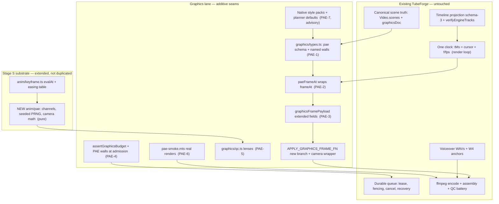

# TubeForge PAE — Phase 0 Audit & Implementation Specification

**STATUS: AWAITING APPROVAL — this was a read-only audit. Zero code was modified during it.**

| | |
|---|---|
| Date | 2026-11-15 (Africa/Lagos) |
| Repo | `/home/z/tubeforge` — branch `s124/element-editor` @ **`60a87e4`** (the S128 tip; clean working tree) |
| External reference | `lemomo-ai/lemo-opuscar` @ shallow anonymous clone to `/tmp/lemo-opuscar` (no tokens used anywhere) |
| Method | 3 parallel read-only evidence audits (engine/render, infra/jobs/CI, timeline/audio/K1/docs) + direct reads of the S120-§8 animation substrate + full external-repo license/technique review |
| Supersedes | nothing; complements `docs/design/s120-2d-animation-roadmap.md` §8 (Stage S) and `docs/audits/s127-roadmap-close.md` (the five prohibitions) |

---

## 0. Executive summary

1. **TubeForge already owns most of a procedural animation engine.** The Stage S substrate (`anim/keyframe.ts`, `anim/easing.ts`, `anim/clock.ts`) is a pure, pinned keyframe/easing/clock core. `graphics/frame.ts#frameAt(doc, tMs)` is already the "scene at time t" function. The K1 rig evaluates FK poses per frame through one shared applier. The S64 purity law and a sweep-hash pin already enforce determinism.
2. **PAE is therefore an additive grammar slice, not a new engine.** It wraps `frameAt` with per-element keyframe tracks, procedural channels (spring / oscillator / noise with a required seed) and a DOM-side virtual camera, serializes through the existing `graphicsFramePayload` seam, and applies through the existing ONE applier. No second clock, no whiteboard change, no new renderer, no new JobKind, no new dependency.
3. **lemo-opuscar is not an animation engine — it is a style-contract and direction-methodology system** built on the *same* deterministic `render(t)` frame-by-frame pipeline TubeForge already uses. Its transferable value is discipline, not code: the world→screen camera law, seeded randomness, per-style frame quantization (on twos), the cue-map-first rhythm law, the readcheck text-hold rule, and the style-pack contract shape. Its docs (all `.md`, including every `STYLE.md`) are **CC BY-NC 4.0** — they must never be copied into TubeForge, a commercial product. Ideas only; native authorship.
4. **Deliverable count:** 9 tickets (PAE-1…PAE-9), P0 = schema + evaluator + compose seam, each independently testable, projected battery growth 765 → ≈ 810.

---

## 1. Deliverable 1 — Current architecture inventory (evidence-based)

### 1.1 The binding laws (verified against the tree)

| Law | Evidence |
|---|---|
| Timeline is a PROJECTION, never the source of truth | `timeline.ts` header; re-derived at every serialize; `verifyEngineTracks` on write AND read |
| One clock | `anim/clock.ts` (`ANIM_FRAME_BUDGET 25_920`, `framePlanWindows`, `quantizeClock`, `frameCountOf`); render loop `tMs = cursorMs + (f/fps)*1000` (`graphics/render.ts` L289); two-clock assert L337 |
| S64 purity (frame truth has no fs/DOM/clock/randomness) | headers of `anim/*`, `graphics/frame.ts`, `graphics/compose.ts`, `characters/rig-frame.ts`; census below (§1.10) |
| Whiteboard tree locked | diff vs base = only `beat-plan.ts` `classifySentence` export (+6/−1) — verified by the audit agent |
| `queue-handlers.ts` zero-diff (no new JobKind; rig is a CHANNEL) | `s128-push.sh` sanity gate #2; `queue-handlers.ts` registers 27 kinds, untouched |
| Zero new dependencies | `s128-push.sh` gate #3 (package.json + bun.lock zero-diff) |
| `transitions.ts` ffmpeg-xfade-native | `s128-push.sh` gate #4 |
| RENDER_MODES lockstep | `RENDER_MODES` lives in **`src/lib/tubeforge/types.ts` L107–150** (not graphics/types.ts); lockstep pin is `render-lane.ts#laneDecisionsComplete` (CI battery L13031+) |
| New engine lane / motion kind = design-doc slice, never drive-by | `render-lane.ts` header; `graphics/types.ts` L11–14; `anim/easing.ts` L61 ("the table — complete and closed") |
| Named walls, refusal names the wall | `GRAPHICS_BUDGETS` (types.ts L321–363), `RIG_BUDGETS`, `assertGraphicsBudget` / `assertRigBudget` before chromium (R-1 delivered arithmetic) |
| "One clock, one mix" — engines render video-only clips | graphics `graphicsEncodeArgs`, rig `rigEncodeArgs` (video-only); `buildSegment` owns the VO mix |
| AI suggests, human approves; never routes | Stage R `director-plan.ts` advisory field + D2 firewall (source-pinned: render/compositor/selector never branch on it) |

### 1.2 The graphics lane (the PAE host)

| File | Purpose | Key exports | ~LOC |
|---|---|---|---|
| `graphics/types.ts` | Grammar contract + validator: closed motion/element sets, budgets, tolerant parse, byte-stable write | `validateGraphicsDoc`, `parseGraphicsDoc`, `writeGraphicsDoc`, `GRAPHICS_BUDGETS`, `GRAPHICS_MOTION_KINDS` | 1372 |
| `graphics/frame.ts` | **The ONE pure frame truth**: motion windows, channels, fixed enter→exit→emphasis composition | `frameAt(doc, tMs)`, `graphicsFrameCount`, `graphicsSceneDurationsMs` | 307 |
| `graphics/compose.ts` | Static SVG skeleton + **the ONE applier** `APPLY_GRAPHICS_FRAME_FN` shared by renderer and editor | `composeGraphicsScene`, `graphicsFramePayload`, `APPLY_GRAPHICS_FRAME_FN` | 752 |
| `graphics/render.ts` | Headless-chromium frame loop + per-scene ffmpeg encode + concat/bed assembly | `renderGraphics`, `graphicsEncodeArgs`, `graphicsAssemblyArgs` | 355 |
| `graphics/preflight.ts` | R-1 pre-flight wall on DELIVERED frames | `assertGraphicsBudget`, `graphicsBudgetReport` | 89 |
| `graphics/qc.ts` | Pre-render QC matrix (fail-closed) + lane-aware post-render holds | `graphicsQcMatrix`, `graphicsHoldWindows` | 251 |
| `graphics/planner.ts` / `llm-planner.ts` | $0 native scaffold / LLM variant (metered, degrades to native) | `scaffoldGraphicsDoc`, `scaffoldGraphicsDocLlm` | 407 / 842 |
| `graphics/editor.ts`, `draft.ts`, `import-store.ts`, `import-validate.ts`, `tracks.ts` | S124 editor brain; draft lane; S126 imports; engine→timeline projection | `graphicsTracks`, … | 89–222 |

The closed motion vocabulary: `GRAPHICS_MOTION_KINDS = ["fade","rise","slide","pop","wipe","count","grow","draw"]` with `ElementMotion { kind, durationMs, delayMs, ease }` — windows on the scene clock, emphasis in-window only.

The per-frame seam (render loop, verbatim shape):
```
for f in 0..frames:
  tMs    = cursorMs + (f/fps)*1000
  payload= graphicsFramePayload(frameAt(doc, tMs))          # pure frame truth
  page.evaluate(APPLY_GRAPHICS_FRAME_FN)(payload)           # absolute-set, idempotent
  page.screenshot(f%05d.jpg)
```
"NO CSS animation anywhere" (compose.ts L18). Per-scene chromium context recycling (the 4 GB OOM receipt); all network routes aborted.

### 1.3 The shared animation substrate — Stage S (S120 §8) — **the PAE foundation that already exists**

- `anim/keyframe.ts` (68): `Keyframe { tMs, value, ease? }` — destination-owned easing; `evalAt(keys, tMs, lerp?)` clamped, strictly-ascending, refuses loudly; `LerpFn` hook for structured values (colors/poses); `keyframes()` sugar.
- `anim/easing.ts` (109): closed `EaseName` table `linear | ease-in-out | ease-out | pop | ease-back`; `evalEase`; `zoomProgressExpr` compiles the same curves into ffmpeg zoompan expressions (byte-pinned against motion.ts). "A new curve is a design-doc slice."
- `anim/clock.ts` (70): `ANIM_FRAME_BUDGET = 25_920` (18 min @ 24 fps), `frameCountOf`, `quantizeClock` (2-dp), `framePlanWindows` (contiguous by construction).

### 1.4 The character rig (K1, S125) — the procedural-pose precedent

- **Pose truth**: `poseAt(rig, timeline, tMs, speech)` — FK-only `M_abs = M_abs(parent) ∘ T ∘ R ∘ S`; pose rows hold from `tMs`, tween `POSE_TWEEN_MS = 320`, destination-owned easing (the "anim/keyframe law"); joints absent → rest.
- **Mouth**: `mouthSchedule` — W4 word anchors → syllable beats strictly inside word spans; deterministic cycle; no narration → closed (honesty ladder).
- **Gestures**: `planRigTimeline` compiles narration → pose rows via the shared `classifySentence`; compile-only (never persisted).
- **Compose seam**: `composeRigScene` builds the skeleton at identity; `APPLY_RIG_FRAME_FN` = the ONE applier (renderer + studio preview).
- **Renderer**: `renderRigScene` — chromium screenshots → video-only clip → composes through the ordinary footage path; sha256-sidecar clip cache (`ensureRigClip`); two-clock assert; `min(fps,30)` timebase.
- **Integration seat**: a CHANNEL (`native-rig`, rule 4.5), not a JobKind; failure → visible Ken Burns fallback (never silent). `RIG_BUDGETS`: 24 parts / 24 poses / 16 joints / 64 rows / 24k SVG chars.
- Status: 23/23 smoke; blind re-score PENDING (≥3 humans — non-fabricable).

### 1.5 Camera today — ffmpeg-side only (story lane)

C2-ext verbs (`shake | push-follow | drift-crawl`) compile to closed-form **ffmpeg zoompan expressions** (`motion.ts#shotZoompan`); zero runtime JS animation. S93 breath rig and Ken Burns share that lane. **There is no DOM-side camera object in the graphics lane** — that is PAE's genuine camera gap.

### 1.6 Timeline (schema-3, Stage X additive core)

- `AssembledTimeline.schema: 1|2|3`; `engineTracks?: TimelineTrack[]` persisted at assemble, **verified, never blind** (`verifyEngineTracks`, ±0.011 s per-scene window agreement with the derived twin); failed verify refuses the whole doc on read.
- Builder registry: `COMPOSITOR_SEGMENT_KINDS = ["video","image"]`; a plan kind without a registered segment builder refuses ("a routing bug"). The per-scene segment-builder dispatch for engine kinds is the **recorded gated half** of Stage X (S129 candidate).
- Engines emit tracks derive-at-render (`graphicsTracks`, `characterTracks`) through `planFromTracks` with the two-clock assert. No producer persists `engineTracks` yet.

### 1.7 Audio / voiceover

Three modes (built-in TTS / upload / URL); providers behind the capability layer (`ai.tts`); per-scene WAVs are truth (existing WAV kept = resume semantics); doc windows derived from **measured WAV durations** (wav + lead 0.35 s + tail 0.85 s) — picture and narration pinned to the same per-scene clock. W4 word anchors feed whiteboard beats, K1 mouth, captions. Final pass: two-pass loudnorm −16 LUFS / −1 dBTP. Voiceover interlock: 409 when `isJobRunning(id,"voiceover")` in every lane that reads the WAVs.

### 1.8 Jobs, tenancy, storage

- Durable DB-backed queue (no Redis): `startJob` idempotency keys, cross-process dedupe, atomic claim with **monotonic `leaseToken` fencing**, 90 s lease + heartbeat, 1 s tick, per-org heavy cap 2 / process cap 8, cancel ≤ 0.5 s, exponential backoff retries, crash recovery with artifact-landed idempotence walls (a landed `final.mp4` is `done`, not re-paid).
- Tenancy: custom HMAC design (next-auth present but unused); `requireUser` + per-org rate limit + ALS `TenantCtx`; `db` $extends injects `organizationId` on 17 scoped models; ESLint bans raw db under `/api`; 120/136 routes call `requireUser`; tenant ctx survives process boundaries (closures re-enter captured ctx; handlers rebuild from the Job row).
- Storage: POSIX keys, local/S3 (zero-dep SigV4), S101 atomic quota reservations; per-scene artifact caches (`scene-NN.mp4`, `scene-rig-NN.mp4`) keyed by content hashes; `SceneArtifact.inputHash` provenance ledger; backups + measured-RTO restore drill in CI.

### 1.9 QC inventory (13-check final battery + engine matrices)

Playability, duration-vs-narration, LUFS, true peak, LRA, black frames, dead air, frozen frames, SRT sanity, tail fade, flicker, stutter, cut alignment — three-state `pass|fail|unmeasured` (unmeasured never reads clean). Plus S53 VLM lenses, S49 content-policy scan, S116 scene recheck + approval gate, S123 graphics pre-render matrix + holds, S117 render-manifest staleness 409, blind-rescore sha256 sessions.

### 1.10 Determinism census (the audit's own scan)

- `Math.random`: 5 hits — proc temp stamps, image-seed fallback, queue backoff jitter, pending-input hash, email ids. **None in frame evaluation.**
- `Date.now` in render-adjacent paths: 1 hit — a slides temp *filename*. Benign.
- Editors preview on a **fixed-delta clock** (`t += 1000/fps` per rAF); the rAF timestamp only throttles UI reports.
- `graphics/frame.ts` is **pinned by a sweep-hash test** (byte-identical output for equal frames).
- `three` (^0.187) is used ONLY by the S94 3D lane (blob-injected into the headless page; no TS import). PAE need not touch it.

### 1.11 CI & scripts

`ci.yml`: secrets (gitleaks) → check (typecheck, lint, unit battery, queue/billing/storage/rate/drill, alert probe) → build → coverage floor → postgres wedge replay → clean-clone → **docker-smoke** (main-push ∨ `workflow_dispatch` ∨ PR label — the S128 fix) → e2e (PR/main). `nightly.yml`: route battery + full e2e. Battery at S128: **765 passed, 0 failed** (receipt; re-verified today — §10).

---

## 2. Deliverable 2 — Capability gap analysis

User's Phase-1 design list mapped to what exists (evidence in §1):

| # | PAE capability | Status | Evidence | Closed by |
|---|---|---|---|---|
| 1 | Deterministic animation runtime | **EXISTS** | `frameAt` pure; S64 law; sweep-hash pin; §1.10 census | PAE-2 extends channels |
| 2 | Animation instruction schema | **PARTIAL** | motion windows + rig pose rows + sprite `frameIndex`; no general per-element keyframe tracks | **PAE-1** |
| 3 | Keyframe & easing system | **EXISTS (Stage S)** | `evalAt`, 5-curve closed table, `LerpFn` hook | PAE-2 adds procedural channels (spring/osc/noise) |
| 4 | 2D renderer adapter | **EXISTS** | graphics compose + ONE applier; rig compose + rig applier | PAE-3 rides it |
| 5 | 3D renderer adapter | **PARTIAL** | S94 `scene3d` lane (three.js, WebGL2) for heavy 3D; CSS 3D unused | PAE-3 = CSS-3D-lite via the same applier; heavy 3D stays in scene3d (no new renderer) |
| 6 | Camera & object animation | **PARTIAL** | ffmpeg-side camera (motion.ts zoompan verbs); rig FK objects; **no DOM-side camera in graphics** | **PAE-2/3** (world→screen camera object) |
| 7 | Timeline event integration | **EXISTS** | schema-3 + `verifyEngineTracks` + per-engine `tracks.ts` | PAE animates inside scene windows; no new clock (PAE-1 note); Stage X gated half = optional landing surface |
| 8 | Frame-level rendering & recovery | **EXISTS (per-scene)** | per-scene clips + hash caches + lease/fencing/recovery + artifact-landed walls | PAE-6 verifies exact re-render (determinism ⇒ re-run = identical bytes) |
| 9 | Animation-specific QC | **PARTIAL** | sweep-hash pin; static-run/flicker/stutter; graphics holds | **PAE-5** (text-hold readability lens, camera bounds, NaN sweep, determinism self-check) |
| 10 | Style-driven visual grammar (lemo-opuscar's core idea) | **MISSING** | planner archetypes only | **PAE-7** (native style packs) |
| 11 | Music-grid cue alignment | **MISSING** | cut alignment exists; beat-grid alignment does not | P2 research note (PAE-9 tail; needs a cue grid source) |

---

## 3. Deliverable 3 — Proposed architecture

**Design decision D1 — PAE rides the graphics lane as an additive grammar slice.** It is NOT a new engine lane (that is a design-doc-slice event with picker/route/compositor lockstep), NOT a new JobKind (queue-handlers zero-diff), NOT a second clock. Precedent: S126 added a sprite channel end-to-end (types payload + frame channel + compose mechanism + applier branch) without touching whiteboard internals; S125 proved "channel, not JobKind".

**D2 — evaluation is a pure wrapper around the existing frame truth.** `paeFrameAt(doc, tMs)` = `frameAt(doc, tMs)` + PAE channel deltas composed AFTER enter→exit→emphasis. Same `tMs` from the render loop. Stage S purity law applies: no fs/DOM/clock/randomness; all randomness is seeded (mulberry32-style PRNG with a required int seed — the lemo-opuscar `lib.js` `mulberry/hash` discipline, re-implemented natively).

**D3 — the camera is one world→screen function per scene** (lemo-opuscar TECHNIQUE §2, adopted as a law): a scene-level virtual camera (keyed pan/zoom/rotate, optional procedural shake reusing the C2 closed-form sinusoid idea in DOM space) applied as a single wrapper transform in compose. Effects that follow subjects go through it; no hand-typed screen coordinates.

**D4 — style packs are data, natively authored.** A PAE style pack is a validated JSON+doc contract (essence; palette; type; motion personality: default eases, durations, quantization `stepFps`; camera grammar table) consumed by the scaffold planners as DEFAULTS. Human-approved, advisory, $0. The *shape* of the contract is inspired by lemo-opuscar's `STYLE.md` structure; the *text* is original (CC BY-NC boundary).



**What PAE deliberately does NOT do:** no whiteboard/ change; no `RENDER_MODES`/`EngineLaneId`/`JobKind`/`queue-handlers.ts` change; no new dependency; no Director routing (style/verb selection is advisory like Stage R); no second clock; no CSS `@keyframes` in engine pages (absolute-set applier only); no unbounded string/number (every dimension gets a named wall).

---

## 4. Deliverable 4 — File-by-file implementation plan

Every ticket: tests + type safety + error handling + security review + perf note + docs + CI, per the Phase-2 protocol. All changes additive unless marked `MODIFY`.

| Ticket | File | Change |
|---|---|---|
| **PAE-1** schema + walls (S) | `src/lib/tubeforge/graphics/types.ts` | ADD `PaeTrack/PaeChannel/PaeCamera/PaeBlock` types + `PAE_BUDGETS` (`keysPerTrackMax`, `channelsPerElementMax`, `animatedElementsPerSceneMax`, `cameraTracksMax=1`, `springStiffness/damping` bounds, seed = int32, `stepFps ∈ {fps, fps/2, fps/3}`); MODIFY `parseGraphicsDoc`/`writeGraphicsDoc` to round-trip the scene-level `pae` block + per-element `anim` tracks (tolerant: junk drops with the named-wall error pattern; required content refuses) |
| | `scripts/test-unit.mts` | ADD walls section: acceptance, boundary values, rejection naming the wall, byte-stable write round-trip |
| **PAE-2** evaluator (M) | `src/lib/tubeforge/anim/pae/evaluate.ts` (new) | `paeFrameAt(doc, tMs)` — composes keyframe tracks (via `evalAt`), procedural channels (closed-form spring; sine oscillator; value-noise w/ seed), quantization (`stepFps`), camera transform; NaN-safe, clamped, in-bounds |
| | `src/lib/tubeforge/anim/pae/rng.ts` (new) | seeded PRNG (mulberry32 re-implementation, credited as a public-domain-family algorithm, original code) |
| | `scripts/test-unit.mts` | determinism double-run deep-equal; golden easing values; spring settle bounds; seed reproducibility; NaN sweep; camera bounds |
| **PAE-3** compose seam (M) | `src/lib/tubeforge/graphics/compose.ts` | MODIFY `graphicsFramePayload` (optional PAE fields, field-conditional like `counterValue`); ADD camera wrapper `<g>`; EXTEND `APPLY_GRAPHICS_FRAME_FN` (absolute-set transform writes incl. optional CSS 3D-lite `perspective/rotateX/Y`) |
| | `scripts/test-unit.mts` | payload snapshot; applier idempotence (double-apply = single-apply) |
| **PAE-4** admission + planner (S) | `src/lib/tubeforge/graphics/preflight.ts` | ADD `assertPaeBudget` inside the existing R-1 wall path (refusal at click, never in a failed job card) |
| | `src/lib/tubeforge/graphics/planner.ts` | ADD optional PAE presets to scaffold (off by default; $0) |
| **PAE-5** QC lenses (S) | `src/lib/tubeforge/graphics/qc.ts` | ADD rows: text-hold readability (hold ≥ max(1.8 s, speech + 0.6 s) — port of the readcheck *formula*, re-expressed natively), camera bounds, determinism self-check (evaluate t twice, hash the frame state) — three-state contract preserved |
| **PAE-6** smoke + CI (M) | `scripts/pae-smoke.mts` (new) | real chromium renders: easing gallery, spring settle, camera push, on-twos quantize; **byte-identity double-run at 24 & 30 fps** (same-host claim — see §9); ffmpeg encode; two-clock assert; receipts to gitignored `validation/` |
| | `.github/workflows/ci.yml` | no trigger change (S128 already fixed); battery count pin updated by PR review note |
| **PAE-7** style packs (M) | `src/lib/tubeforge/graphics/pae-styles/*.json` + loader (new) | native contracts; validated against a schema; planner defaults; provenance header "original, clean-room inspired"; studio picker advisory |
| **PAE-8** direction presets (L, optional) | `src/lib/tubeforge/graphics/pae-styles/presets.ts` | named bundles (push-in emphasis, breathing hold, hold-and-release) compiled to channel defaults; advisory `engineProposalReport`-style surface; never routes |
| **PAE-9** benchmarks + docs (L) | `docs/baselines/pae-*.md` (new) + `docs/design/pae-engine.md` (new) | three productions + metrics (§6.3); the design record + license note |

Dependency changes: **none.** `package.json`/`bun.lock` stay zero-diff (CI battery + push-script gate re-assert it).

---

## 5. Deliverable 5 — Dependency & licensing assessment

### 5.1 TubeForge dependencies

**Zero new dependencies required.** Easing/PRNG/interpolation/camera math are stdlib TypeScript. `three@0.187` already exists (S94 lane) — PAE v1 does not need it. The branch law (package.json + bun.lock zero-diff) is preserved by construction.

### 5.2 lemomo-ai/lemo-opuscar — license tiers (read from its LICENSE + REUSE.toml, 2026-11-15)

| Material | License | TubeForge implication |
|---|---|---|
| Code: `core/`, `tools/`, `styleboard/`, `plugin/`, demo code | **MIT** | Concepts may be studied freely; we still re-implement natively (clean-room discipline already in force) |
| **ALL Markdown — including every `STYLE.md` — and image-gen prompts** | **CC BY-NC 4.0** | **Never copy text into TubeForge** (a commercial product/service = "commercial advantage" use, which needs a paid commercial license). Style packs must be natively authored |
| Demo films, stills, posters | CC BY 4.0 (attribution) | Out of scope; would require per-asset attribution + CREDITS — not worth it |
| Third-party assets inside demos (fonts/music/footage/data) | their own licenses | N/A |
| "Clawd" character | excluded / Anthropic's | N/A |
| Films users make *with* the library | user's own | N/A |

### 5.3 Clean-room register — new entry

lemo-opuscar joins the existing register (friction, Synfig, Theatre.js, FreeMoCap, Effekseer, OpenVDB, OpenToonz) as **entry #8: conceptual reference only; no dependency; no text, prompt, artwork, film, or audio reuse; native authorship for anything user-visible.** The existing provenance-tagging law for imported assets is unchanged.

### 5.4 No external API calls

PAE adds none. Scaffold/planner AI remains optional behind the existing `aiCall` metering + $5 spend door; the $0 native path always exists (native-first law).

---

## 6. Deliverable 6 — Test & benchmark strategy

### 6.1 Unit battery (rides `scripts/test-unit.mts`)

| Suite | Tests (approx) |
|---|---|
| PAE-1 walls: accept/boundary/refuse-with-named-wall/round-trip write | +12 |
| PAE-2 evaluator: determinism double-run, golden curves, spring bounds, seed reproducibility, NaN sweep, camera bounds | +14 |
| PAE-3 payload + applier idempotence | +6 |
| PAE-5 QC lenses (three-state) | +6 |
| PAE-7 style-pack parsing + provenance | +6 |
| **Projected battery** | **765 → ≈ 809, 0 failed** |

### 6.2 Smoke (`scripts/pae-smoke.mts`, k1-rig-smoke pattern)

Real chromium+ffmpeg renders asserting: structural walls; easing-gallery frames sampled and state-hashed; **double-run byte-identity at 24 and 30 fps** (JPEG screenshots, same host — the claim k1 smoke already makes honestly); two-clock assert; cache reuse by hash. Receipts to gitignored `validation/`.

### 6.3 Phase-3 production benchmarks (post-approval, PAE-9)

Three productions, all inside the 25,920-frame wall: **historical** (≤ 90 s), **educational** (≤ 150 s), **motion-graphics** (≤ 45 s). Measured per production:

| Metric | Method |
|---|---|
| Render performance | wall-clock per 1,000 delivered frames; peak RSS (the 4 GB worker receipt is the regression tripwire) |
| Reproducibility | sha256 of `final.mp4` across two full re-renders, same host |
| Audio synchronization | per-scene window vs measured WAV offset (two-clock assert + QC duration check) |
| Recovery | kill the worker mid-render → restart → artifact-landed idempotence re-renders the missing scene → byte-identical clip; measured time |
| Cost | $0 mandatory path (native-first); optional LLM scaffold metered via `UsageRecord` |
| Visual quality | existing QC battery + VLM lenses (unmeasured stays honest) + **blind human scores ≥ 3 raters** per the established rubric pattern (non-fabricable) |

---

## 7. Deliverable 7 — Prioritized implementation tickets

| # | Ticket | Size | Priority | Independent acceptance |
|---|---|---|---|---|
| PAE-1 | PAE schema + named walls in graphics/types.ts | S | **P0** | walls refuse/refuse-loudly with named errors; byte-stable round-trip; engine ignores-then-parses cleanly; battery green |
| PAE-2 | `anim/pae` pure evaluator + seeded PRNG | M | **P0** | determinism double-run deep-equal; golden curve values; no DOM/fs/clock; battery green |
| PAE-3 | compose payload + ONE-applier branch + camera wrapper | M | **P0** | payload snapshot; applier idempotence; editor still edits rest pose (documented); battery green |
| PAE-4 | admission (`assertPaeBudget`) + scaffold presets | S | P1 | refusal at click names the wall; $0 planner path renders without AI |
| PAE-5 | QC lenses (readability hold, camera bounds, determinism self-check) | S | P1 | three-state rows; unmeasured stays honest |
| PAE-6 | `pae-smoke.mts` real renders + byte-identity | M | P1 | 24/30 fps double-run byte-identical; two-clock assert; receipts |
| PAE-7 | native style packs + planner defaults + picker | M | P2 | packs validate; defaults flow; zero lemo bytes; docs |
| PAE-8 | direction presets (advisory) | L | P2 | proposal-report surface; never routes; human approves |
| PAE-9 | benchmarks + design record + license note | L | P2 | three productions with measured metrics; blind scores scheduled (human gate) |

Sequencing: PAE-1 → 2 → 3 are the independently testable core (each lands dark-safe: a doc without PAE blocks renders byte-identically today). 4–6 light it up inside the graphics lane. 7–9 are product surface. **K1-before-Stage-X law respected:** PAE consumes no Stage-X gated half; if a compositor segment builder for a PAE-heavy lane is ever wanted, that is a separate design-doc slice with the registry (all-or-nothing law).

---

## 8. Restriction & prohibition compliance matrix

| Restriction (user spec / house law) | Compliance mechanism |
|---|---|
| Preserve project/scene source-of-truth | PAE schema rides `graphicsDoc`; `Video.scenes` untouched; timeline stays projection |
| Reuse timeline/asset/audio/render/job/storage/QC | §3 diagram — every arrow lands on an existing module |
| No competing Director / pipeline | No new lane/JobKind/RENDER_MODE; advisory-only style & preset surfaces |
| Deterministic, time-based rendering | `paeFrameAt` pure; seeded PRNG; Stage S laws; sweep/double-run pins |
| AI providers optional | native-first; $0 path; `aiCall` metering unchanged |
| Scene-level editing, repair, selective regeneration | S124 editor unaffected (rest-pose editing documented); S112–S116 flows untouched |
| Security, cost controls, reliability | walls named; R-1 admission; tenant scoping untouched; $5 door unchanged; per-scene caches unchanged |
| No wholesale copying of lemo-opuscar | clean-room register #8; CC BY-NC docs never enter the repo |
| No replacement of infrastructure without evidence | §2 gap table: every "EXISTS" is reused, every "MISSING" is additive |
| No uncontrolled external API calls | zero new outbound calls |
| No automatic destructive scene modifications | PAE is render-time evaluation; it never writes scenes |
| No weakening of security boundaries | requireUser/tenant/interlock paths untouched; VO interlock reused |
| Five prohibitions (no 2nd clock / no whiteboard edit / no new renderer / no Director routing / no new deps) | §3 "deliberately does NOT do" list |

---

## 9. Risks & honest unknowns

1. **Cross-host byte-identity is NOT claimed.** JPEG screenshots + chromium builds differ across machines; the double-run identity claims are same-host (the same honest scope k1 smoke uses). Structural determinism (frame-state hashes) is the cross-host contract.
2. **Chromium font/text metrics** affect text-channel determinism — graphics pages are self-contained today; PAE adds no fonts; the determinism self-check is state-level, not pixel-level.
3. **Editor semantics:** S124 edits the rest pose; PAE motion is preview/render-time. The studio preview must run the same `paeFrameAt` (ONE applier law) — editor UX note in PAE-3.
4. **Stage X gated half is tempting** — the registry is a natural landing surface, but per the K1-before-X law it stays closed until S129; PAE does not require it.
5. **Music-grid cue alignment** (lemo-opuscar's strongest rhythm idea) needs a beat-grid source TubeForge does not yet model — recorded as a P2 research tail, not smuggled in.
6. **CI battery count comment drift:** `ci.yml`'s check-job comment references an older battery count (676) vs the live 765 — a one-line comment fix bundled into the first PAE PR (not done now: read-only audit).
7. **Worker-parallel per-frame rendering** is enabled by determinism but is NOT proposed for v1 (sequential per-scene loop is proven; parallelism is a perf research ticket if benchmarks demand it).

---

## 10. What happened outside the audit (disclosed)

- **Nothing was built in this audit.** The only repo actions were reads plus a background re-run of the gates (typecheck / lint / battery / k1-rig-smoke) as QC evidence.
- **S128 was already closed before this audit** (commits `d9e3256` + `60a87e4`, receipt `S128-execution-receipt.md`: 765/765 + 23/23; bundle `s128-execution.bundle` + `s128-push.sh` + receipt delivered). The gates re-run today re-asserts that baseline on the exact tree audited here.
- **Security:** a fourth GitHub PAT was pasted into chat in the prior session; none of the four tokens was used anywhere; all access (including the lemo-opuscar clone) was anonymous. All four remain compromised and must be revoked at github.com/settings/tokens.

---

## Appendix A — evidence log

- 3 parallel read-only audits (graphics/render; infra/jobs/CI; timeline/audio/K1/docs) — full reports on file with the session; key citations embedded above with file:line references.
- Direct reads: `anim/keyframe.ts`, `anim/easing.ts`, `anim/clock.ts`, `graphics/types.ts` motion block, `package.json`, `s128-push.sh`, `S128-execution-receipt.md`.
- External: `git clone --depth 1 https://github.com/lemomo-ai/lemo-opuscar.git /tmp/lemo-opuscar` (anonymous); read `LICENSE` (6.7 KB), `TECHNIQUE.md`, `DIRECTOR.md`, `styles/watercolor/{STYLE.md,style.json}`, `REUSE.toml` (styles rules), `package.json`, `requirements*.txt`.
- Gates re-run: daemonized background run of `bun run typecheck`, `bun run lint`, `bun run test`, `node --import tsx scripts/k1-rig-smoke.mts` — results recorded in the delivery receipt for this audit.

## Appendix B — lemo-opuscar idea traceability (adopted / rejected)

**Adopted as clean-room concepts (no bytes):**
1. "The picture is a function of time" + any-frame-any-order determinism → already house style; PAE generalizes to per-element channels; enables future frame sharding (research only).
2. World→screen camera function (never hand-typed coordinates) → PAE camera object law (D3).
3. Per-style frame quantization ("animate on twos, camera smooth") → `stepFps` channel property.
4. Seeded randomness (`mulberry` + `hash` discipline) → `anim/pae/rng.ts` (native implementation).
5. Cue-map-first rhythm + automated cue-vs-visual check → P2 music-cue QC tail (PAE-9 note).
6. Readcheck text-hold formula (≥ max(1.8 s, speech + 0.6 s)) → PAE-5 readability lens (formula re-expressed natively).
7. "Blend every pose with keyframes+easing; never switch inside an if" → already the K1 law; extended to PAE channels.
8. Grain in ffmpeg, not in the page → matches the existing W7 finishing layer; no change needed.
9. Style-contract *shape* (essence / what-it-is-not / materials / color logic / type / motion quality / camera grammar table) → PAE-7 pack schema shape, text natively authored.
10. Treatment-first + benchmark discipline + "common failures" checklist → PAE-9 production briefs + QC checklist.

**Rejected / out of scope:**
- WebGL post passes (film damage, CRT, ink redraw) — new-renderer law; heavy 3D stays in the S94 scene3d lane.
- Python audio stack (numpy/scipy synthesis, sample sampler, Kokoro/edge-tts/faster-whisper) — covered by the provider layer + music library; zero new deps.
- Any STYLE.md / DIRECTOR.md / demo code text reuse — CC BY-NC + clean-room: never.
- Their 1920×1080/−14 LUFS defaults — TubeForge keeps its own contract (−16 LUFS target, doc-driven sizes).

---

**END OF PHASE 0 — submitted for approval. On approval, implementation starts at PAE-1 under the Phase-2 protocol (one independently testable capability at a time).**
